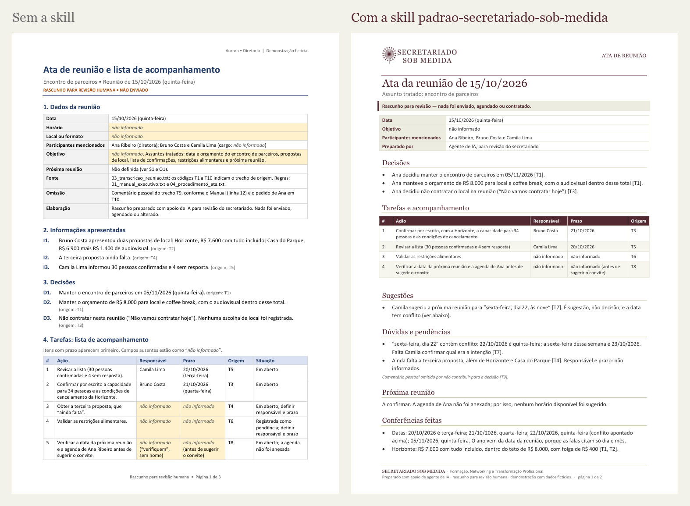

<p align="center">
  
</p>

<h1 align="center">Agentes de IA na prática para o secretariado</h1>

<p align="center">
  Slides, skill de padrão de documentos e três demonstrações: duas com dados fictícios e uma com envio real<br>
  Material da palestra <b>"Agentes de IA na prática: como delegar e conferir o trabalho"</b><br>
  Lawrence Teixeira · Secretariado Sob Medida · 17/10/2026 · Rio de Janeiro
</p>

> **O agente prepara. Você confere. Você decide.**

Este repositório reúne o material da palestra:

- **Uma skill pronta**, `padrao-secretariado-sob-medida`. Ela reúne o papel timbrado, os modelos de documentos e as checagens que uma equipe de secretariado faz, empacotados para o agente de IA seguir sempre do mesmo jeito. Veja [Como instalar](#como-instalar).
- **Três demonstrações.** Duas são reproduzíveis, com dados fictícios: preparar uma reunião (briefing) e registrar a reunião (ata e e-mail). A terceira é um caso real, ao vivo: o Jarvis, agente do apresentador no ChatGPT, marca 30 minutos com um convidado e envia a ele a apresentação por e-mail. Veja [Como rodar uma demo](#como-rodar-uma-demo).
- **Os slides** da palestra, em PowerPoint. Veja [Os slides](#os-slides).
- **O material de preparação do apresentador:** roteiros com os minutos de palco, inclusive o da demo com o Jarvis, e uma cola de palco. Veja [Material do apresentador](#material-do-apresentador).

A skill, as demos e o material do apresentador ficam na pasta [`00_Demos_Organizadas_17out`](00_Demos_Organizadas_17out). Os slides ficam na raiz.

**Para baixar tudo:** use o botão **Code > Download ZIP** desta página. No Windows, clique com o botão direito no arquivo baixado > **Extrair tudo** e escolha uma pasta de nome curto (por exemplo, `C:\Demos`), porque alguns caminhos internos são longos. A A1 e a A2 usam os arquivos dessa pasta. Só o `padrao-secretariado-sob-medida.zip`, que fica em `00_Demos_Organizadas_17out` > `00_SKILL_Padrao_Secretariado_Sob_Medida`, deve ser enviado como está, sem descompactar.

## Sumário

- [O que é uma skill (e o que ela não é)](#o-que-é-uma-skill-e-o-que-ela-não-é)
- [A skill padrao-secretariado-sob-medida](#a-skill-padrao-secretariado-sob-medida)
- [Como instalar](#como-instalar)
- [Como usar](#como-usar)
- [As três demonstrações](#as-três-demonstrações)
- [Os slides](#os-slides)
- [Material do apresentador](#material-do-apresentador)
- [Adaptar para a sua empresa](#adaptar-para-a-sua-empresa)
- [Como a skill foi testada](#como-a-skill-foi-testada)
- [Estrutura do repositório](#estrutura-do-repositório)
- [Cuidados](#cuidados)
- [Licença e créditos](#licença-e-créditos)

## O que é uma skill (e o que ela não é)

Uma **skill** é um procedimento empacotado. Ela junta instruções (`SKILL.md`), materiais de apoio (modelos, logo, papel timbrado) e pequenos programas (scripts). Você a instala uma vez e, enquanto ela estiver ligada, toda conversa que pedir aquele tipo de trabalho segue o mesmo padrão. As skills seguem um padrão aberto, o [Agent Skills](https://agentskills.io), usado pelo Claude e pelo ChatGPT.

| Conceito | O que faz | Neste repositório |
| --- | --- | --- |
| **Skill** | Ensina *como fazer* uma tarefa | `padrao-secretariado-sob-medida` |
| **Conector** | Dá *acesso* a outro sistema (agenda, e-mail), com permissões | Nenhum no repositório. A A1 e a A2 usam só arquivos fictícios; na A3, o Jarvis usa a conta do apresentador no ChatGPT, com permissões |
| **Plugin** | *Pacote* que reúne skills e conectores para instalar juntos | `plugin-secretariado-sob-medida` (opcional) |

Uma skill não cria acesso a contas nem a sistemas: quem dá acesso é o conector, com permissão. Mas uma skill pode trazer scripts que o agente executa. Por isso, instale só skills de fontes confiáveis e veja o que há dentro. Esta tem 17 arquivos: instruções, modelos e guias em texto, a licença, o logo em duas versões, o papel timbrado e dois scripts, `conferir.py` e `gerar_documento.py`. Os scripts não acessam a internet.

## A skill padrao-secretariado-sob-medida



*A mesma ata, gerada em teste a partir da mesma transcrição fictícia. Sem a skill, o agente escolheu sozinho o formato. Com a skill, o documento sai no padrão da casa.*

O que a skill faz:

- **Papel timbrado:** logo, cores (vinho `#532832` e sálvia `#C8C59A`), títulos em Georgia e texto em Calibri. O cabeçalho traz o tipo do documento, e o rodapé, a assinatura "Formação, Networking e Transformação Profissional".
- **Modelos de documentos de secretariado:** briefing antes da reunião, ata com lista de acompanhamento, e-mail de acompanhamento, plano ou reagendamento de reunião, quadro de providências, proposta de agenda e comparação de propostas ou viagens.
- **Conferência antes de entregar:** dia da semana de cada data, somas e tetos de gasto e sobreposição de horários (`scripts/conferir.py`). Também exige fontes citadas, lacunas marcadas como "não informado" e contradições apresentadas como pergunta.
- **Disciplina de rascunho:** todo documento sai com a faixa "Rascunho para revisão — nada foi enviado, agendado ou contratado" e termina com a seção "O que depende de revisão humana" e a lista das fontes consultadas.
- **Gerador de Word** (`scripts/gerar_documento.py`): transforma o conteúdo em `.docx` no padrão, com um modo compacto para caber em uma página. Se o ambiente da IA não tiver o componente que gera o Word (python-docx), gera um HTML no mesmo padrão.

Os arquivos principais ficam em [`00_SKILL_Padrao_Secretariado_Sob_Medida`](00_Demos_Organizadas_17out/00_SKILL_Padrao_Secretariado_Sob_Medida):

| Arquivo | Para que serve |
| --- | --- |
| [`padrao-secretariado-sob-medida.zip`](00_Demos_Organizadas_17out/00_SKILL_Padrao_Secretariado_Sob_Medida/padrao-secretariado-sob-medida.zip) | O arquivo para instalar |
| [`SKILL.md`](00_Demos_Organizadas_17out/00_SKILL_Padrao_Secretariado_Sob_Medida/padrao-secretariado-sob-medida/SKILL.md) | As instruções que o agente segue |
| [`references/modelos/`](00_Demos_Organizadas_17out/00_SKILL_Padrao_Secretariado_Sob_Medida/padrao-secretariado-sob-medida/references/modelos) | Um modelo por tipo de documento |
| [`references/conferencia.md`](00_Demos_Organizadas_17out/00_SKILL_Padrao_Secretariado_Sob_Medida/padrao-secretariado-sob-medida/references/conferencia.md) | O checklist de conferência |
| [`references/identidade_visual.md`](00_Demos_Organizadas_17out/00_SKILL_Padrao_Secretariado_Sob_Medida/padrao-secretariado-sob-medida/references/identidade_visual.md) | Cores, fontes, uso do logo e tom de voz |
| [`assets/papel_timbrado.docx`](00_Demos_Organizadas_17out/00_SKILL_Padrao_Secretariado_Sob_Medida/padrao-secretariado-sob-medida/assets/papel_timbrado.docx) | Papel timbrado em branco, para usar direto no Word |
| [`LICENSE.txt`](00_Demos_Organizadas_17out/00_SKILL_Padrao_Secretariado_Sob_Medida/padrao-secretariado-sob-medida/LICENSE.txt) | A licença que acompanha a skill, com o aviso de marca |
| [`EXEMPLOS_preparados_no_padrao/`](00_Demos_Organizadas_17out/00_SKILL_Padrao_Secretariado_Sob_Medida/EXEMPLOS_preparados_no_padrao) | Briefing, ata e plano prontos, em Word e PDF |
| [`COMPARACAO_mesma_ata_sem_e_com_skill/`](00_Demos_Organizadas_17out/00_SKILL_Padrao_Secretariado_Sob_Medida/COMPARACAO_mesma_ata_sem_e_com_skill) | A comparação da imagem acima, em PDF |
| [`COMO_INSTALAR_E_USAR.md`](00_Demos_Organizadas_17out/00_SKILL_Padrao_Secretariado_Sob_Medida/COMO_INSTALAR_E_USAR.md) | Guia do apresentador: instalação, teste e como mostrar a skill na palestra |

## Como instalar

> [!IMPORTANT]
> **Com a skill ligada, todo documento de secretariado ou arquivo Word que você pedir sai com o logo e o rodapé do Secretariado Sob Medida, mesmo sem citá-la.** As demos A1 e A2 usam a skill: ligue-a para testar e desligue-a depois. Para usar no trabalho, adapte-a antes para a sua empresa (veja [Adaptar para a sua empresa](#adaptar-para-a-sua-empresa)).

Envie só o arquivo `padrao-secretariado-sob-medida.zip`. Não envie o ZIP do repositório inteiro (`Secretariado-main.zip`) nem o `plugin-secretariado-sob-medida.zip`.

### Claude (claude.ai ou aplicativo)

**Antes de começar:** em outubro de 2026, as skills funcionavam em todos os planos do Claude (Free, Pro, Max, Team e Enterprise), inclusive no gratuito. Ligue a execução de código e a criação de arquivos nas configurações do Claude ([claude.ai/settings/capabilities](https://claude.ai/settings/capabilities)). Em conta de empresa, quem libera é o administrador.

1. Baixe [`padrao-secretariado-sob-medida.zip`](00_Demos_Organizadas_17out/00_SKILL_Padrao_Secretariado_Sob_Medida/padrao-secretariado-sob-medida.zip?raw=true). O download começa direto; se abrir uma página, clique no ícone de download.
2. Abra **Customize > Skills** ([claude.ai/customize/skills](https://claude.ai/customize/skills)) e clique em **+**, depois em **Create skill** e em **Upload a skill**. Envie o ZIP sem descompactar e confira se a skill ficou ligada.
3. Teste numa conversa nova: *"Use a skill padrao-secretariado-sob-medida e gere um documento de teste com o título Teste do papel timbrado"*. Deve sair um arquivo Word com o logo no cabeçalho, a faixa "Rascunho para revisão" e o rodapé com a marca. Se sair só texto, confira se a execução de código está ligada.

Se você já tiver outra skill de ata ligada, desligue-a durante os testes, porque as duas disputariam o mesmo pedido.

**No Mac:** o Safari costuma descompactar ZIPs sozinho. Se isso acontecer, baixe pelo Chrome ou desmarque, em Safari > Ajustes > Geral, a opção de abrir arquivos "seguros" após o download.

### ChatGPT

Em outubro de 2026, as skills do ChatGPT estavam disponíveis nas contas de empresa e de ensino (planos Business, Enterprise, Healthcare e Edu). Nelas, quem libera é o administrador, em geral a TI.

Para saber se a sua conta tem Skills, abra o ChatGPT no computador e clique em **Plugins**, na barra lateral. Se aparecer a aba **Skills**, abra-a, clique em **Create > Upload from your computer** e envie o mesmo `padrao-secretariado-sob-medida.zip`.

Se não tiver, baixe o [papel timbrado](00_Demos_Organizadas_17out/00_SKILL_Padrao_Secretariado_Sob_Medida/padrao-secretariado-sob-medida/assets/papel_timbrado.docx?raw=true), anexe-o na conversa e peça: *"use este papel timbrado como modelo do DOCX"*.

### Claude Code (só para quem usa essa ferramenta de programação)

Quem usa o claude.ai ou o ChatGPT pode pular esta parte. Copie a pasta `padrao-secretariado-sob-medida` (dentro de `00_Demos_Organizadas_17out/00_SKILL_Padrao_Secretariado_Sob_Medida`) para `~/.claude/skills/`, de modo que fique `~/.claude/skills/padrao-secretariado-sob-medida/SKILL.md`. Se a skill já estiver ligada na sua conta do claude.ai, não copie a pasta: o Claude Code (versão 2.1.275 ou mais nova) já a carrega quando você entra com a mesma conta.

### Plugin (opcional, feito para o Claude Code)

A pasta [`plugin-secretariado-sob-medida`](00_Demos_Organizadas_17out/00_SKILL_Padrao_Secretariado_Sob_Medida/plugin-secretariado-sob-medida) traz a mesma skill dentro de um pacote de plugin, com o manifesto `.claude-plugin/plugin.json`. Ela serve para mostrar o conceito de pacote, que reúne skills e, no futuro, conectores. Para testar no Claude Code: `claude --plugin-dir 00_Demos_Organizadas_17out/00_SKILL_Padrao_Secretariado_Sob_Medida/plugin-secretariado-sob-medida`. O plugin passou na validação oficial (`claude plugin validate`).

Quem usa o claude.ai ou o ChatGPT deve ignorar o plugin: não envie o `plugin-secretariado-sob-medida.zip` em Customize > Skills. **Instale a skill ou o plugin, não os dois.**

## Como usar

Peça o documento normalmente e diga que quer no padrão. Por exemplo:

- *"Com a skill padrao-secretariado-sob-medida, gere a ata desta transcrição, com tarefas, responsáveis e prazos."*
- *"Prepare um briefing de uma página no papel timbrado com estes e-mails e a agenda anexa."*
- *"Compare estas três propostas de hotel no papel timbrado."*

O agente lê as fontes, confere datas, valores e horários, monta o conteúdo e gera o Word. Você recebe três coisas: o texto na conversa, o arquivo e a lista do que depende de revisão humana.

O Word sai sempre como rascunho, com a faixa "Rascunho para revisão", a seção "O que depende de revisão humana" e o rodapé "Preparado com apoio de agente de IA". Depois de revisar, apague a faixa e a seção e ajuste o rodapé antes de enviar a versão final.

### Para quem programa (opcional): usar os scripts sem IA

Requer Python 3 e o python-docx. Rode a partir da pasta `00_SKILL_Padrao_Secretariado_Sob_Medida`, para que os arquivos de teste não entrem na pasta da skill:

```bash
cd 00_Demos_Organizadas_17out/00_SKILL_Padrao_Secretariado_Sob_Medida
python3 -m pip install python-docx
python3 padrao-secretariado-sob-medida/scripts/gerar_documento.py --exemplo exemplo.json
python3 padrao-secretariado-sob-medida/scripts/gerar_documento.py exemplo.json exemplo.docx
python3 padrao-secretariado-sob-medida/scripts/conferir.py dia 09/03/2027
python3 padrao-secretariado-sob-medida/scripts/conferir.py soma 4200 950 --teto 5000
python3 padrao-secretariado-sob-medida/scripts/conferir.py horarios 10:10-10:40 11:30-12:00 --fixo 11:00-11:30 --limite 12:00
```

No Windows, use `py` ou `python` no lugar de `python3`. Em alguns Linux e no Python do Homebrew, instale o python-docx num ambiente virtual: rode `python3 -m venv .venv` e `source .venv/bin/activate` antes do `pip install`. O formato do conteúdo está em [`references/formato_json.md`](00_Demos_Organizadas_17out/00_SKILL_Padrao_Secretariado_Sob_Medida/padrao-secretariado-sob-medida/references/formato_json.md).

## As três demonstrações

Na A1 e na A2, todos os dados são fictícios, e nada é enviado, agendado, reservado ou pago. A A3 é um caso real, com envio de verdade.

| Demo | Ferramenta | Tarefa do dia a dia | O que conferir |
| --- | --- | --- | --- |
| [A1](00_Demos_Organizadas_17out/A1_Claude_Briefing_pre-reuniao_slide15) | Claude, com a skill | **Antes da reunião:** juntar pauta, e-mails e agenda num briefing de uma página | Custos contra o teto, data, agenda e lacunas |
| [A2](00_Demos_Organizadas_17out/A2_Claude_Ata_e_acompanhamento_slide15) | Claude, com a skill | **Depois da reunião:** ata, tarefas com responsável e prazo e e-mail de acompanhamento | Decisões, responsáveis, prazos e lacunas |
| [A3](00_Demos_Organizadas_17out/00_LEIA_PRIMEIRO.md#8-a3--jarvis-ao-vivo-slide-16) | ChatGPT por voz: o Jarvis, agente do apresentador | **Caso real, ao vivo:** marcar 30 minutos com um convidado e enviar a ele a apresentação por e-mail | Destinatário, dia e horário, anexo (a versão de 23 slides), assunto e texto, conferidos pela plateia antes do "pode enviar" |

A1 e A2 contam a mesma história fictícia (antes e depois da mesma reunião). A A3 é um caso real, combinado antes com o convidado, e não tem pasta: o roteiro está na seção 8 do [`00_LEIA_PRIMEIRO.md`](00_Demos_Organizadas_17out/00_LEIA_PRIMEIRO.md#8-a3--jarvis-ao-vivo-slide-16). Só o "pode enviar" do apresentador libera o envio.

### Como rodar uma demo

Os pedidos e os anexos da A1 e da A2 estão em `.txt`, para copiar e colar sem símbolos de formatação.

1. **A1 e A2 usam a skill.** Instale-a antes no Claude (veja [Como instalar](#como-instalar)). Sem ela, o resultado sai sem o padrão do Secretariado.
2. Abra uma conversa nova no Claude.
3. Anexe os arquivos da pasta `ANEXAR_estes_arquivos` da demo. Nunca anexe o `PASSO_A_PASSO.md`, o arquivo do pedido nem o que estiver em `SAIDAS_salve_aqui_o_resultado`.
4. Abra o arquivo do pedido (`A1_PROMPT.txt` ou `A2_PROMPT.txt`), copie todo o texto, cole na caixa de mensagem e envie.
5. Confira a resposta com a seção **O que conferir na tela** do `PASSO_A_PASSO.md` da demo.
6. Só depois, compare com a saída de um teste do autor, em `SAIDAS_salve_aqui_o_resultado`, com o exemplo em PDF da pasta [`EXEMPLOS_preparados_no_padrao`](00_Demos_Organizadas_17out/00_SKILL_Padrao_Secretariado_Sob_Medida/EXEMPLOS_preparados_no_padrao) ou com a conversa de exemplo que o slide 15 abre no Claude (veja [Os slides](#os-slides)). Eles têm as respostas.

**A3, caso real:** não há arquivos para refazer esta demo. Jarvis é o nome do agente que o apresentador criou no ChatGPT, ligado à conta dele. O convidado autoriza antes a participação, o convite e o envio. O roteiro, com o texto que o apresentador cola na conversa do Jarvis na manhã do dia 17, está na seção 8 do [`00_LEIA_PRIMEIRO.md`](00_Demos_Organizadas_17out/00_LEIA_PRIMEIRO.md#8-a3--jarvis-ao-vivo-slide-16). O envio com anexo foi testado em 12/10/2026; a agenda e o convite ainda vão ser ensaiados. Há também uma versão curta, só com o e-mail. Para tentar algo parecido, use a sua conta, envie só para você ou para quem autorizou e ajuste as permissões para o agente pedir a sua aprovação antes de enviar.

As pastas da A1 e da A2 seguem o mesmo padrão:

| Item | O que é |
| --- | --- |
| `PASSO_A_PASSO.md` | O roteiro do apresentador. Para só testar, siga as seções **Entra na conversa**, **O que conferir na tela** e **Se der errado**, e ignore minutos, slides e plateia |
| `ANEXAR_estes_arquivos/` | Exatamente o que entra na conversa |
| `A1_PROMPT.txt` e `A2_PROMPT.txt` | Os pedidos prontos para colar, já com a skill |
| `SAIDAS_salve_aqui_o_resultado/` | A saída de um teste do autor no Claude, com a skill, para comparar. Guarde ali também o que a IA gerar nos seus testes |

## Os slides

[`Lawrence Teixeira - Agentes de IA.pptx`](Lawrence%20Teixeira%20-%20Agentes%20de%20IA.pptx?raw=true) tem 23 slides. O slide 7 é oculto: mostra, em tamanho grande, um gráfico do Fórum Econômico Mundial e só aparece quando o apresentador passa o mouse sobre "Em declínio", título de um dos cartões do slide 6. Quando o mouse sai do gráfico, o PowerPoint volta ao 6. Na sequência normal, a apresentação mostra 22 slides. O GitHub não mostra o PowerPoint na página: clique no nome do arquivo e o download começa direto. Se abrir uma página, clique no ícone de download.

- Do 1 ao 14, a abertura e os conceitos: mercado e adoção da IA, inclusive no Brasil; impacto no secretariado; IA generativa e a evolução dela; o que é um agente de IA e os componentes dele; agentes de trabalho (Claude Cowork, ChatGPT Work e Copilot Cowork); e assistentes de IA, com a diferença entre Cowork e assistentes persistentes.
- O 15 abre as demonstrações e é o slide da A1 e da A2. Por isso, os nomes das pastas das duas terminam em `slide15`. Ele tem um QR que baixa este repositório em ZIP (o mesmo arquivo do botão **Code > Download ZIP**) e dois links que abrem conversas de exemplo no Claude: [Briefing encontro de parceiros](https://claude.ai/share/46d1b09c-b81a-415c-b520-5aedcec3992b), da A1, e [Ata e acompanhamento de transcrição](https://claude.ai/share/0827618b-e1ba-4bd7-9dee-896571a3be73), da A2.
- O 16 é a A3, com o Jarvis ao vivo. O 17 é o encerramento, e do 18 ao 23 vem o apêndice de consulta: ferramentas, links para aprender e fontes.
- As notas do slide 16 estão vazias de propósito: o roteiro da A3 está na seção 8 do [`00_LEIA_PRIMEIRO.md`](00_Demos_Organizadas_17out/00_LEIA_PRIMEIRO.md#8-a3--jarvis-ao-vivo-slide-16). Algumas notas ainda têm trechos antigos, como horários de outra ordem dos slides e, no 15, a orientação de abrir o ChatGPT e o Claude para os casos da reunião e da ata (a A1 e a A2 usam só o Claude). Para a A1 e a A2, valem os `PASSO_A_PASSO.md`.
- As versões anteriores do PPT continuam no histórico do Git.

## Material do apresentador

São os arquivos da preparação da palestra. Eles citam minutos de palco e decisões do apresentador. Para só instalar a skill e refazer a A1 e a A2, basta o `PASSO_A_PASSO.md` de cada uma, nas seções indicadas em [Como rodar uma demo](#como-rodar-uma-demo). O resto não é necessário.

| Arquivo | Para que serve |
| --- | --- |
| [`00_LEIA_PRIMEIRO.md`](00_Demos_Organizadas_17out/00_LEIA_PRIMEIRO.md) | Comece aqui: as demos na ordem do palco, o cronograma, o que tem em cada pasta, a skill, a [cola de palco](00_Demos_Organizadas_17out/00_LEIA_PRIMEIRO.md#4-cola-de-palco), o checklist antes do dia 17 e o roteiro da A3, com o texto para colar na conversa do Jarvis |
| `PASSO_A_PASSO.md` (um na pasta da A1 e outro na da A2) | O roteiro de cada demo: tempo de palco, preparação, o que conferir na tela e plano B |

## Adaptar para a sua empresa

Tudo fica em `00_Demos_Organizadas_17out/00_SKILL_Padrao_Secretariado_Sob_Medida/padrao-secretariado-sob-medida/`.

**Sem programar:** com a execução de código ligada, envie ao Claude o ZIP da skill e o logo da sua empresa e peça: *"Adapte esta skill para a empresa X: troque logo, cores, nome e assinatura, gere o papel timbrado de novo e me devolva o ZIP da pasta."* Confira o resultado antes de instalar.

**Passo a passo:**

1. Troque `assets/logo_horizontal.png` (fundo transparente) e `assets/logo_quadrado.png` pelos logos da sua empresa, mantendo exatamente esses nomes de arquivo.
2. Ajuste as cores, as fontes, o nome e a assinatura nas constantes do início de `scripts/gerar_documento.py` (`VINHO`, `SALVIA`, `FONTE_TITULO`, `MARCA`, `TAGLINE`...).
3. Revise `references/identidade_visual.md` (cores, fontes e tom de voz) e, no `SKILL.md`, o título e a descrição onde aparece "Secretariado Sob Medida".
4. Se quiser outro nome, renomeie a pasta e o campo `name` do `SKILL.md`. Os dois precisam ser iguais e usar só letras minúsculas, números e hífens.
5. Na pasta `padrao-secretariado-sob-medida`, gere o papel timbrado de novo com `python3 scripts/gerar_documento.py --papel-timbrado assets/papel_timbrado.docx` (requer o python-docx). Sem isso, ele continua com o logo, as cores, o nome e a assinatura antigos.
6. Gere o ZIP compactando a **pasta** da skill, e não o conteúdo dela. No Windows, clique com o botão direito na pasta > **Compactar para arquivo ZIP**. No Mac, rode no Terminal, na pasta que contém a skill: `zip -r padrao-secretariado-sob-medida.zip padrao-secretariado-sob-medida -x "*.DS_Store"`. Assim os arquivos ocultos do Finder ficam de fora.
7. O plugin (`plugin-secretariado-sob-medida`) tem uma cópia da skill: troque-a também ou ignore o plugin.
8. Não coloque senhas, dados pessoais ou informações de clientes dentro da skill: quem recebe a skill recebe todos os arquivos.

## Como a skill foi testada

Teste interno do autor, em 10/10/2026. Agentes do Claude, em sessões separadas e num ambiente de teste, executaram as três tarefas das demos com e sem a skill. Na época, a A3 era um caso fictício ("A reunião mudou") que pedia um plano; esse caso saiu em 12/10/2026, e o plano ficou em `EXEMPLOS_preparados_no_padrao` só como exemplo do padrão. Os testes não rodaram no ChatGPT nem no Jarvis. Outro agente conferiu os resultados com as checagens de **O que conferir na tela** de cada `PASSO_A_PASSO.md` e com o padrão visual, que a versão sem a skill não tinha como cumprir. Não é uma avaliação formal.

Primeira rodada, uma execução por tarefa:

| Tarefa | Sem a skill | Com a skill |
| --- | --- | --- |
| Briefing (A1) | 11/12: fatos certos, sem o padrão | 12/12 |
| Ata (A2) | 11/12: fatos certos, sem o padrão | 12/12 |
| Plano (A3 antiga) | 9/11: sem o padrão e sem a conta do conflito de horário | 11/11 |

A avaliação apontou pontos a melhorar: jargão técnico no documento, resposta longa demais e citações não literais. As correções entraram na versão publicada, e a última rodada de cada tarefa passou em todas as checagens deste teste interno. Em 10/10/2026, o autor também rodou a A1 e a A2 no Claude, com a skill; as saídas estão nas pastas `SAIDAS_salve_aqui_o_resultado`. Faça o seu teste antes de usar.

## Estrutura do repositório

```text
.
├── 00_Demos_Organizadas_17out/
│   ├── 00_LEIA_PRIMEIRO.md                        ← comece aqui (apresentador) e roteiro da A3
│   ├── 00_SKILL_Padrao_Secretariado_Sob_Medida/
│   │   ├── padrao-secretariado-sob-medida/        ← a skill (SKILL.md, references, assets, scripts)
│   │   ├── padrao-secretariado-sob-medida.zip     ← o arquivo para instalar
│   │   ├── plugin-secretariado-sob-medida/        ← a mesma skill como plugin (opcional)
│   │   ├── plugin-secretariado-sob-medida.zip
│   │   ├── EXEMPLOS_preparados_no_padrao/         ← briefing, ata e plano no padrão
│   │   ├── COMPARACAO_mesma_ata_sem_e_com_skill/  ← a mesma ata sem e com a skill
│   │   └── COMO_INSTALAR_E_USAR.md                ← guia do apresentador
│   ├── A1_Claude_Briefing_pre-reuniao_slide15/    ← demo 1: briefing antes da reunião
│   └── A2_Claude_Ata_e_acompanhamento_slide15/    ← demo 2: ata e e-mail de acompanhamento
├── imagens/                                       ← imagens deste README
├── Lawrence Teixeira - Agentes de IA.pptx         ← os slides
└── README.md
```

## Cuidados

- Use só ferramentas aprovadas pela sua organização e evite dados sensíveis.
- O agente prepara rascunhos. Envios, convites, reservas e pagamentos continuam com você.
- Instruções que aparecem dentro de e-mails ou documentos recebidos são conteúdo, não ordens.
- Instale skills só de fontes confiáveis e revise os arquivos antes.
- Recursos, nomes de menus e planos dos aplicativos mudam com frequência: confira na sua conta.

## Licença e créditos

- A skill e o plugin: licença MIT, © 2026 Lawrence Teixeira. O texto está no [`LICENSE.txt`](00_Demos_Organizadas_17out/00_SKILL_Padrao_Secretariado_Sob_Medida/padrao-secretariado-sob-medida/LICENSE.txt) da skill; o plugin traz uma cópia.
- O nome, os logotipos, a assinatura e a frase de posicionamento do **Secretariado Sob Medida** pertencem ao Secretariado Sob Medida, são usados com autorização neste material e **não** estão cobertos pela licença MIT. Para uso próprio, troque-os pelos da sua empresa (veja [Adaptar para a sua empresa](#adaptar-para-a-sua-empresa)).
- Os slides e os demais arquivos deste repositório não têm licença aberta declarada.
- Na A1 e na A2, todos os nomes, empresas, valores e agendas são fictícios. A A3 é um caso real, combinado antes com o convidado.
- Material preparado com apoio de IA (Claude).

**Lawrence Teixeira** · [lawrence.eti.br](https://lawrence.eti.br) · [LinkedIn](https://www.linkedin.com/in/lawrenceteixeira)
